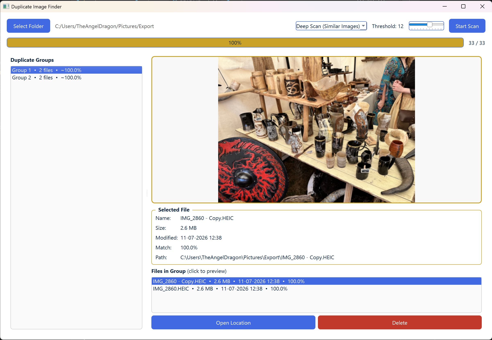

# Duplicate Image Finder

A simple way to search and find duplicate images.



Supports quick scan which finds exact images or deep scan which looks for close matches

Supports many popular formats such as JPEG, PNG, GIF and even HEIC/HEIF formats.

## Build
For use with Pyinstaller

```
pyinstaller main.py --onefile -w
```

## Support me on Ko-Fi!
Any help is appreciated!
<a href='https://ko-fi.com/U7U237CYT' target='_blank'></a>
